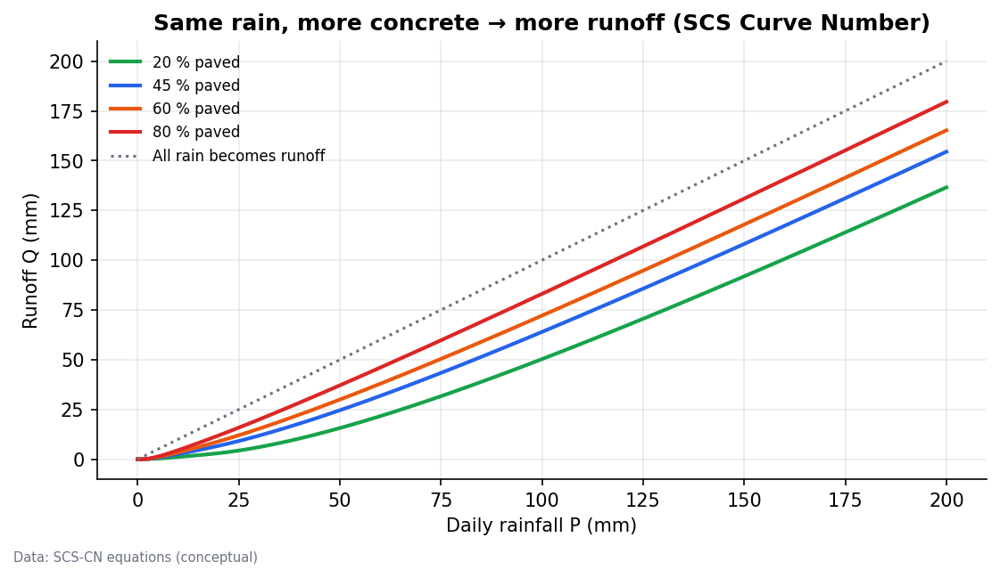
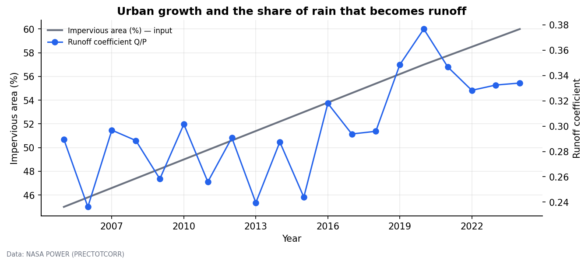
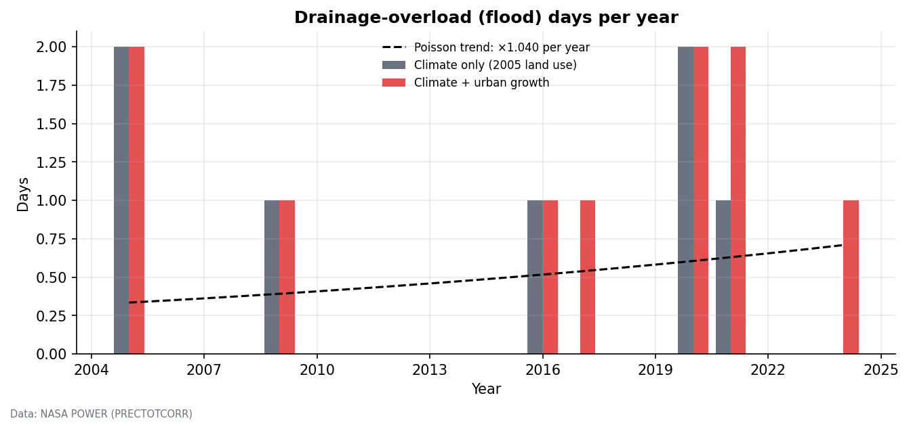
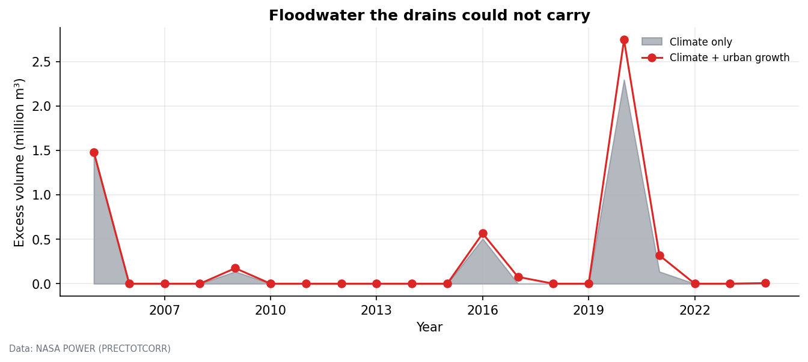
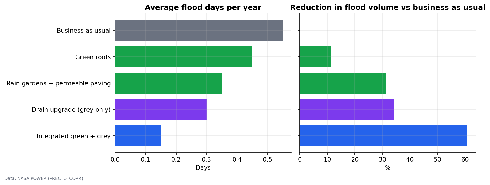
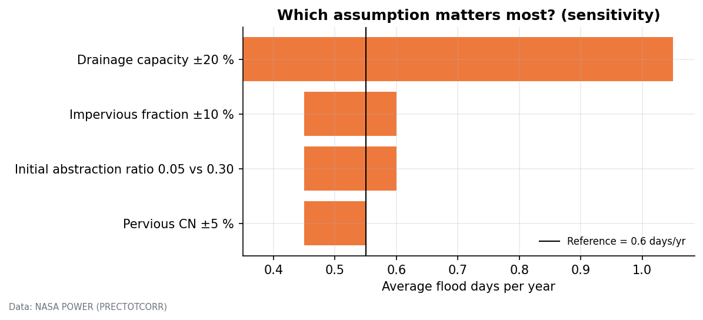

# Project 2 Results — Lagos Metropolitan Area, Nigeria, 2005–2024

*Auto-generated. Rainfall: NASA POWER (PRECTOTCORR). Catchment 25.0 km², drainage capacity 40 mm/day, CN pervious 74 / impervious 98. Impervious fraction 45 % → 60 % (check `config.yaml` — replace placeholder values with your GHSL measurements).*

## 1. Flood-trend statistics

| Variable | Scenario | Mean | Sen's slope /yr | % change over period | MK p | Result |
|---|---|---|---|---|---|---|
| Flood days/yr | Climate + urban | 0.5 | +0 | +0.0 % | 0.439 | no significant trend |
| Flood days/yr | Climate only | 0.35 | +0 | +0.0 % | 0.863 | no significant trend |
| Excess volume (m³/yr) | Climate + urban | 2.68e+05 | +0 | +0.0 % | 0.618 | no significant trend |
| Excess volume (m³/yr) | Climate only | 2.28e+05 | +0 | +0.0 % | 0.864 | no significant trend |
| Runoff coefficient | Climate + urban | 0.298 | +0.00414 | +26.4 % | 0.004 | significant increase |
| Runoff coefficient | Climate only | 0.261 | +0.000292 | +2.1 % | 0.922 | no significant trend |
| Max daily runoff (mm) | Climate + urban | 41.1 | +0.217 | +10.0 % | 0.770 | no significant trend |
| Max daily runoff (mm) | Climate only | 38.7 | -0.0248 | -1.2 % | 0.922 | no significant trend |

**Poisson regression of flood days (climate + urban):** IRR = 1.040 (95 % CI 0.933–1.160), p = 0.478, dispersion = 1.26. In plain English: the expected number of flood days changes by **+4.0 % per year**, i.e. ×2.12 over 19 years.
With land use frozen at 2005, the same model gives IRR = 0.977 (p = 0.719).

## 2. Attribution — how much is climate, how much is urban growth?

Change in the average of 2015–2024 compared with 2005–2014:

| Quantity | Total change | Due to rainfall change | Due to urban growth | Urban share |
|---|---|---|---|---|
| flood_days | +0.4 | +0.1 | +0.3 | 75 % |
| excess_volume_m3 | +2.06e+05 | +1.32e+05 | +7.36e+04 | 36 % |
| runoff_mm | +59.1 | -1 | +60.1 | 102 % |

*Method: run the model twice — once with real land-use growth, once with land use frozen at 2005. The difference between the two runs is the effect of urbanisation.*

## 3. Sustainable drainage (SuDS) scenarios

Each scenario applies 2024 land use to all 20 years of observed rainfall.

| Scenario | Flood days/yr | Excess m³/yr | Runoff coeff. | Flood-day reduction | Volume reduction |
|---|---|---|---|---|---|
| Business as usual | 0.55 | 301,039 | 0.333 | 0 % | 0 % |
| Green roofs | 0.45 | 267,341 | 0.304 | 18 % | 11 % |
| Rain gardens + permeable paving | 0.35 | 206,822 | 0.290 | 36 % | 31 % |
| Drain upgrade (grey only) | 0.30 | 198,397 | 0.333 | 45 % | 34 % |
| Integrated green + grey | 0.15 | 117,534 | 0.261 | 73 % | 61 % |

**Best performing strategy:** Integrated green + grey (61 % less floodwater).

## 4. Sensitivity analysis

| Parameter varied | Flood days/yr (low) | Flood days/yr (high) |
|---|---|---|
| Drainage capacity ±20 % | 1.05 | 0.35 |
| Impervious fraction ±10 % | 0.45 | 0.60 |
| Initial abstraction ratio 0.05 vs 0.30 | 0.60 | 0.45 |
| Pervious CN ±5 % | 0.45 | 0.55 |

The result is most sensitive to **drainage capacity** — this is the parameter most worth measuring carefully.

## Figures

