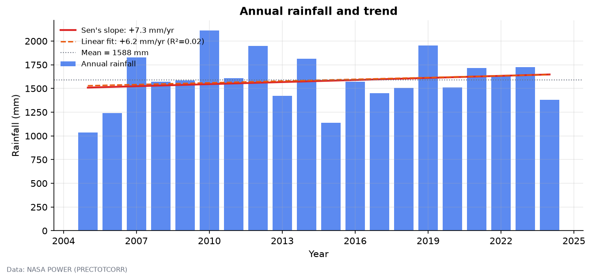
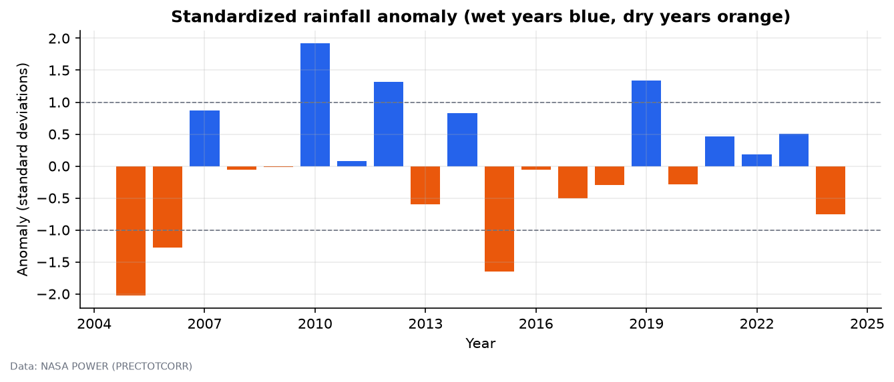
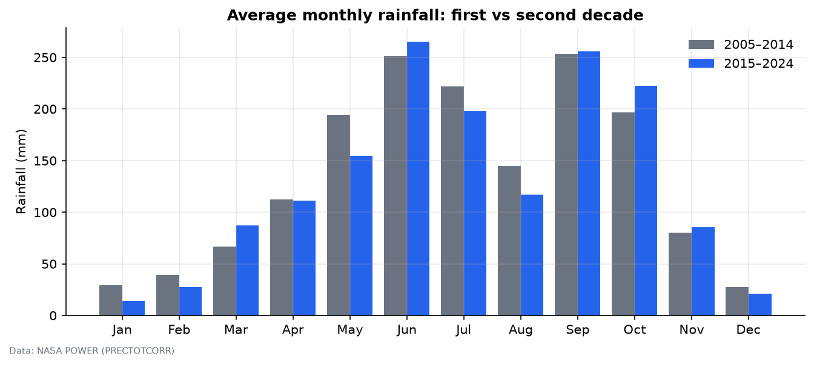
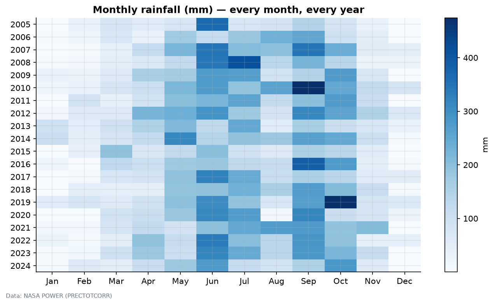
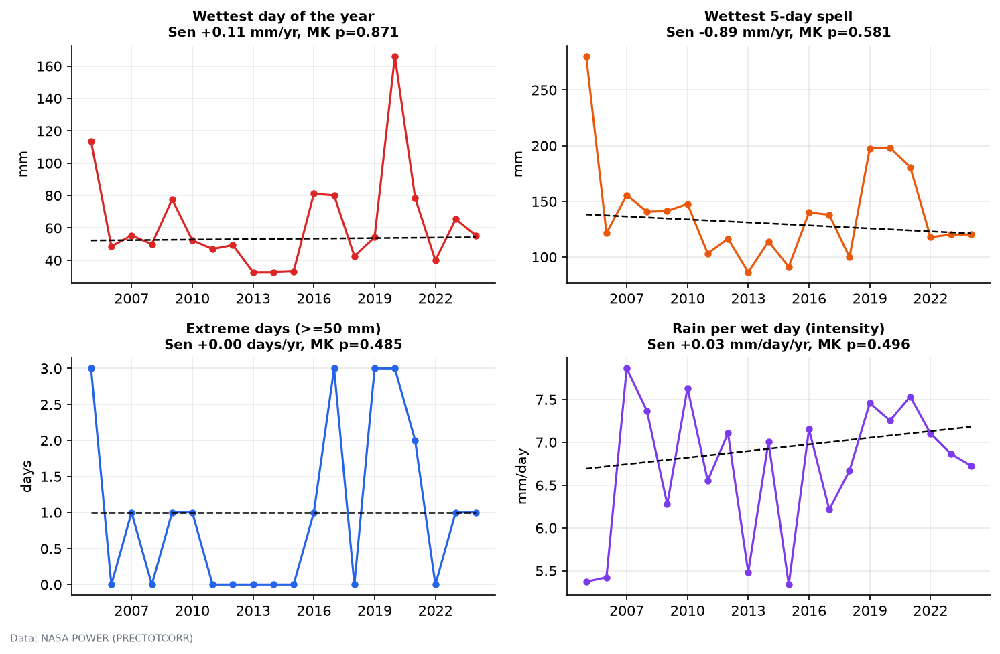
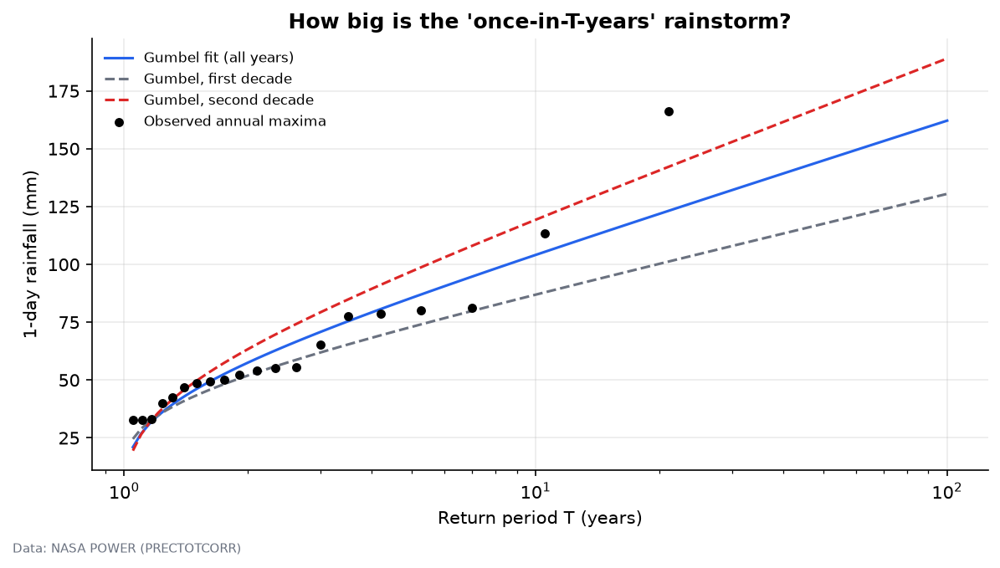
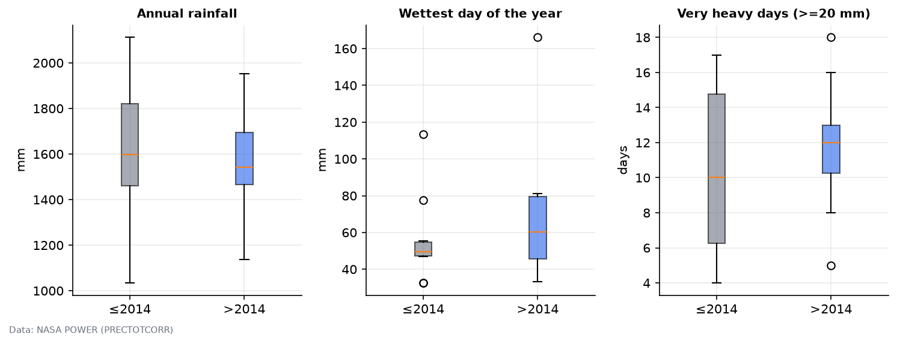

# Project 1 Results — Lagos Metropolitan Area, Nigeria, 2005–2024

*Produced by `analysis.py`. Data source: NASA POWER (PRECTOTCORR). Years analysed: 20. Wet-day threshold: 1.0 mm. 95th-percentile wet-day rainfall: 19.5 mm.*

## 1. Headline numbers

| Statistic | Value |
|---|---|
| Mean annual rainfall | 1588 mm |
| Standard deviation | 273 mm |
| Coefficient of variation | 17.2 % |
| Wettest year | 2010 (2112 mm) |
| Driest year | 2005 (1034 mm) |
| Wettest single day | 166.1 mm in 2020 |
| Mean PCI | 13.2 |

## 2. Trend tests (Mann-Kendall + Sen's slope + linear regression)

| Index | Mean | Sen's slope /yr | Change over period | MK Z | MK p | Result |
|---|---|---|---|---|---|---|
| Annual rainfall (mm) | 1587.7 | +7.292 | +8.7 % | +0.42 | 0.673 | no significant trend |
| Wet-day rainfall total (mm) | 1554.4 | +7.949 | +9.7 % | +0.36 | 0.721 | no significant trend |
| Number of wet days (days) | 230.6 | -0.500 | -4.1 % | -0.45 | 0.649 | no significant trend |
| Rain per wet day (intensity) (mm/day) | 6.7 | +0.026 | +7.3 % | +0.68 | 0.496 | no significant trend |
| Wettest day of the year (mm) | 62.8 | +0.105 | +3.2 % | +0.16 | 0.871 | no significant trend |
| Wettest 5-day spell (mm) | 140.6 | -0.895 | -12.1 % | -0.55 | 0.581 | no significant trend |
| Heavy-rain days (>=10 mm) (days) | 42.0 | +0.000 | +0.0 % | -0.07 | 0.948 | no significant trend |
| Very heavy days (>=20 mm) (days) | 11.1 | +0.218 | +37.4 % | +0.91 | 0.362 | no significant trend |
| Extreme days (>=50 mm) (days) | 1.0 | +0.000 | +0.0 % | +0.70 | 0.485 | no significant trend |
| Rain from extreme days (>P95) (mm) | 367.7 | +6.064 | +31.3 % | +1.01 | 0.315 | no significant trend |
| Share of rain from extreme days (%) | 23.4 | +0.301 | +24.4 % | +0.88 | 0.381 | no significant trend |
| Longest dry spell (days) | 37.4 | -0.333 | -17.0 % | -0.59 | 0.558 | no significant trend |
| Longest wet spell (days) | 61.0 | -1.354 | -42.1 % | -1.40 | 0.163 | no significant trend |
| Precipitation Concentration Index (-) | 13.2 | -0.027 | -3.9 % | -0.68 | 0.496 | no significant trend |

**Interpretation:** 
No index shows a statistically significant trend at the 5 % level. With only 20 years of data, modest trends may exist but cannot be confirmed, so the Sen's slopes above show the direction and size of change rather than proven trends.

## 3. Seasonal (monthly) trends

| Month | Mean (mm) | Sen's slope (mm/yr) | MK p | Result |
|---|---|---|---|---|
| Jan | 22 | +0.22 | 0.673 | no significant trend |
| Feb | 33 | -0.22 | 0.922 | no significant trend |
| Mar | 77 | +0.54 | 0.456 | no significant trend |
| Apr | 112 | +2.74 | 0.127 | no significant trend |
| May | 174 | -1.83 | 0.417 | no significant trend |
| Jun | 258 | -0.19 | 1.000 | no significant trend |
| Jul | 210 | +0.30 | 0.922 | no significant trend |
| Aug | 131 | -2.78 | 0.456 | no significant trend |
| Sep | 255 | +1.43 | 0.456 | no significant trend |
| Oct | 209 | +3.39 | 0.230 | no significant trend |
| Nov | 83 | +1.54 | 0.183 | no significant trend |
| Dec | 24 | -0.03 | 0.922 | no significant trend |

## 4. Change point and decade comparison

Pettitt test on annual rainfall: K = 34, p = 0.876. Most probable shift after **2006** (mean 1137 mm before vs 1638 mm after) — not statistically significant.

| Index | 2005–2014 mean | 2015–2024 mean | % change | Welch p | Mann-Whitney p |
|---|---|---|---|---|---|
| Annual rainfall | 1616.3 | 1559.1 | -3.5 % | 0.652 | 0.571 |
| Number of wet days | 239.0 | 222.1 | -7.1 % | 0.135 | 0.096 |
| Rain per wet day (intensity) | 6.6 | 6.8 | +3.4 % | 0.546 | 0.791 |
| Wettest day of the year | 55.9 | 69.6 | +24.6 % | 0.348 | 0.241 |
| Wettest 5-day spell | 140.8 | 140.4 | -0.2 % | 0.987 | 0.970 |
| Very heavy days (>=20 mm) | 10.4 | 11.8 | +13.5 % | 0.497 | 0.596 |
| Extreme days (>=50 mm) | 0.6 | 1.4 | +133.3 % | 0.131 | 0.135 |
| Rain from extreme days (>P95) | 327.8 | 407.7 | +24.3 % | 0.239 | 0.273 |

## 5. Extreme rainfall return levels (Gumbel)

Gumbel parameters (all years): location u = 48.5 mm, scale α = 24.7 mm. Kolmogorov-Smirnov goodness-of-fit p = 0.476 (Gumbel fits acceptably).

| Return period (years) | 1-day rainfall, all years (mm) | first decade (mm) | second decade (mm) |
|---|---|---|---|
| 2 | 57.6 | 52.0 | 63.4 |
| 5 | 85.6 | 73.0 | 97.0 |
| 10 | 104.1 | 86.9 | 119.3 |
| 25 | 127.5 | 104.5 | 147.4 |
| 50 | 144.9 | 117.5 | 168.3 |
| 100 | 162.2 | 130.5 | 189.0 |

**Key finding:** the storm that was a *1-in-10-year* event in the first decade (87 mm/day) behaves like a **1-in-3.7-year** event in the second decade — it has become more frequent.

## 6. Figures

