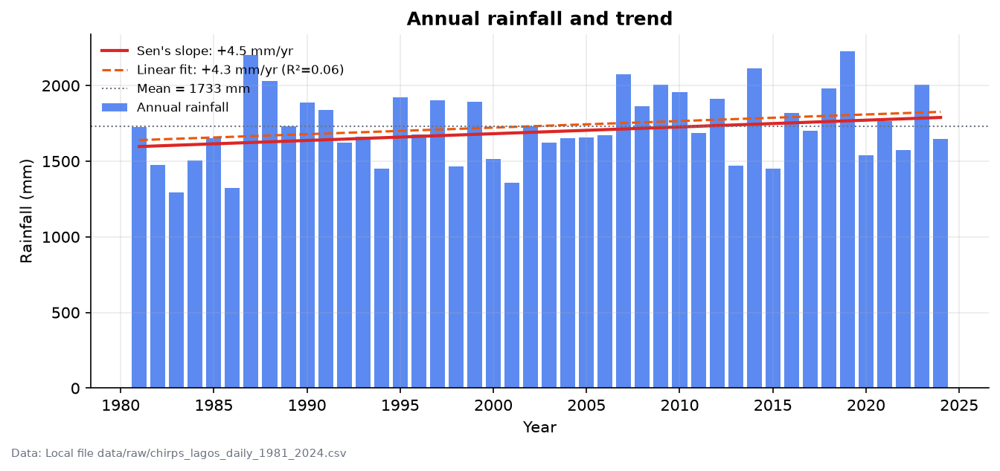
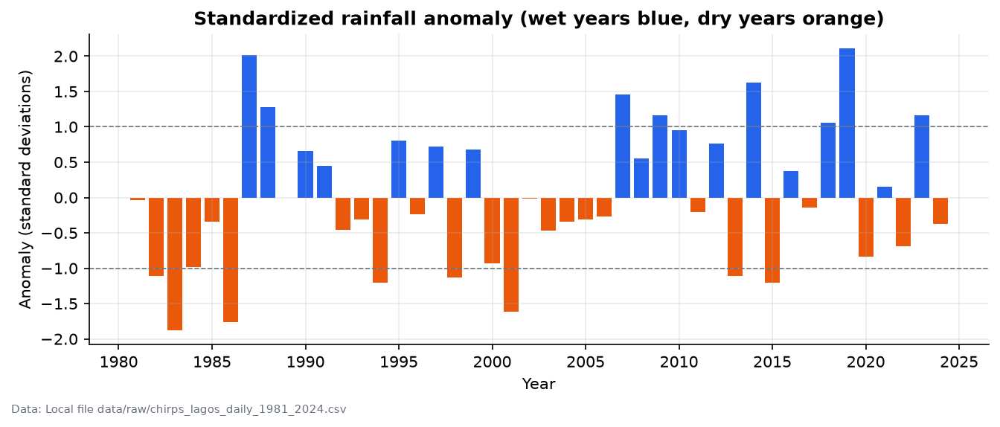
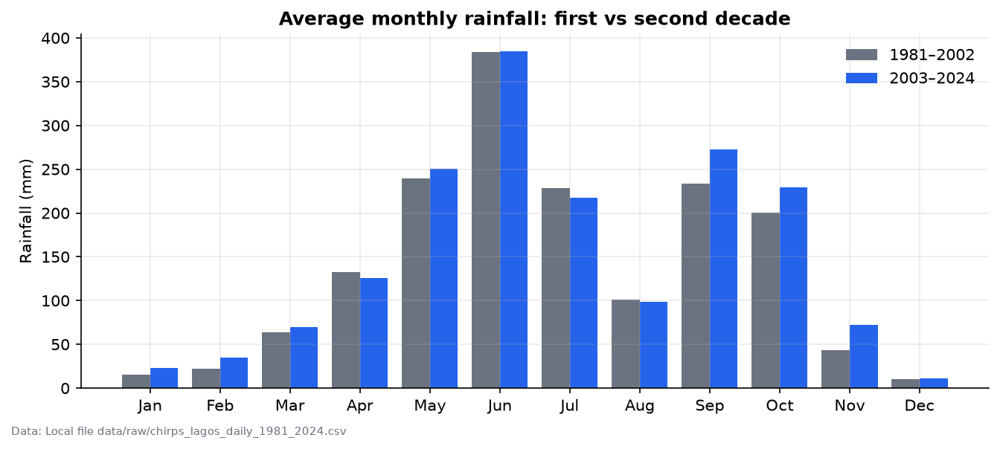
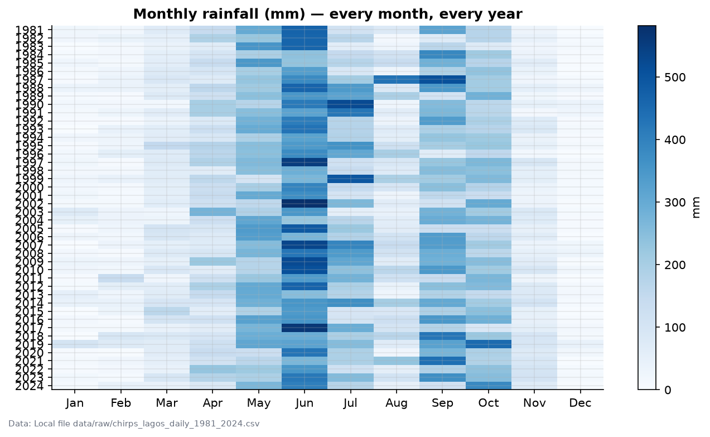
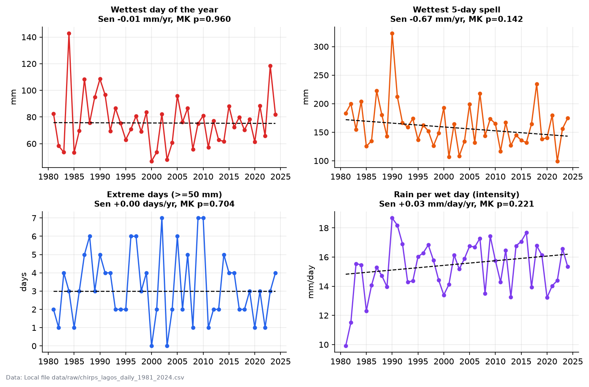
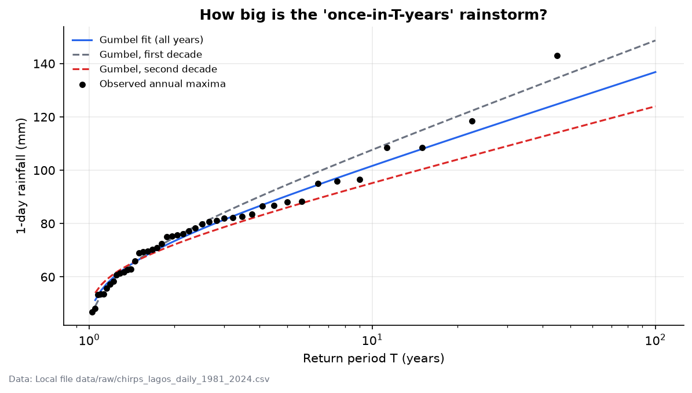
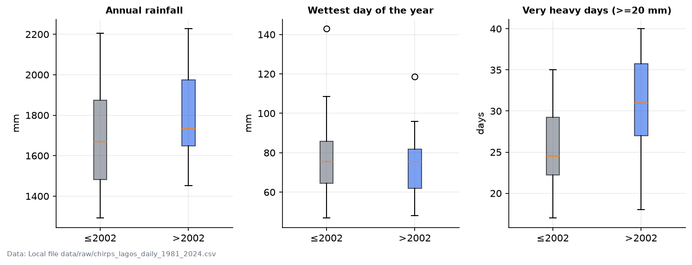

# Project 1 Results — Lagos Metropolitan Area, Nigeria, 1981–2024

*Produced by `analysis.py`. Data source: Local file data/raw/chirps_lagos_daily_1981_2024.csv. Years analysed: 44. Wet-day threshold: 1.0 mm. 95th-percentile wet-day rainfall: 42.5 mm.*

## 1. Headline numbers

| Statistic | Value |
|---|---|
| Mean annual rainfall | 1733 mm |
| Standard deviation | 234 mm |
| Coefficient of variation | 13.5 % |
| Wettest year | 2019 (2227 mm) |
| Driest year | 1983 (1292 mm) |
| Wettest single day | 142.9 mm in 1984 |
| Mean PCI | 15.0 |

## 2. Trend tests (Mann-Kendall + Sen's slope + linear regression)

| Index | Mean | Sen's slope /yr | Change over period | MK Z | MK p | Result |
|---|---|---|---|---|---|---|
| Annual rainfall (mm) | 1732.9 | +4.472 | +11.1 % | +1.51 | 0.132 | no significant trend |
| Wet-day rainfall total (mm) | 1732.2 | +4.476 | +11.1 % | +1.57 | 0.117 | no significant trend |
| Number of wet days (days) | 114.3 | +0.158 | +6.0 % | +0.65 | 0.517 | no significant trend |
| Rain per wet day (intensity) (mm/day) | 15.3 | +0.032 | +9.0 % | +1.22 | 0.221 | no significant trend |
| Wettest day of the year (mm) | 76.6 | -0.014 | -0.8 % | -0.05 | 0.960 | no significant trend |
| Wettest 5-day spell (mm) | 162.7 | -0.671 | -17.7 % | -1.47 | 0.142 | no significant trend |
| Heavy-rain days (>=10 mm) (days) | 61.7 | +0.225 | +15.7 % | +1.81 | 0.070 | no significant trend |
| Very heavy days (>=20 mm) (days) | 28.2 | +0.193 | +29.4 % | +2.72 | 0.007 | significant increase |
| Extreme days (>=50 mm) (days) | 3.2 | +0.000 | +0.0 % | -0.38 | 0.704 | no significant trend |
| Rain from extreme days (>P95) (mm) | 326.7 | +0.373 | +4.9 % | +0.19 | 0.848 | no significant trend |
| Share of rain from extreme days (%) | 18.6 | -0.047 | -10.9 % | -0.29 | 0.769 | no significant trend |
| Longest dry spell (days) | 31.0 | +0.077 | +10.7 % | +0.79 | 0.429 | no significant trend |
| Longest wet spell (days) | 8.2 | +0.000 | +0.0 % | -0.88 | 0.378 | no significant trend |
| Precipitation Concentration Index (-) | 15.0 | -0.039 | -11.2 % | -2.15 | 0.031 | significant decrease |

**Interpretation:** 
Statistically significant changes (5 % level) were found in: very heavy days (>=20 mm) (up 29 % over the period); precipitation concentration index (down 11 % over the period).

## 3. Seasonal (monthly) trends

| Month | Mean (mm) | Sen's slope (mm/yr) | MK p | Result |
|---|---|---|---|---|
| Jan | 19 | +0.00 | 0.960 | no significant trend |
| Feb | 29 | +0.11 | 0.564 | no significant trend |
| Mar | 67 | +0.18 | 0.620 | no significant trend |
| Apr | 129 | -0.34 | 0.436 | no significant trend |
| May | 245 | -0.17 | 0.895 | no significant trend |
| Jun | 384 | -0.09 | 0.927 | no significant trend |
| Jul | 223 | +0.55 | 0.564 | no significant trend |
| Aug | 100 | +0.54 | 0.436 | no significant trend |
| Sep | 253 | +1.32 | 0.413 | no significant trend |
| Oct | 215 | +1.45 | 0.056 | no significant trend |
| Nov | 58 | +1.27 | <0.001 | significant increase |
| Dec | 11 | +0.03 | 0.656 | no significant trend |

## 4. Change point and decade comparison

Pettitt test on annual rainfall: K = 170, p = 0.273. Most probable shift after **2006** (mean 1671 mm before vs 1822 mm after) — not statistically significant.

| Index | 1981–2002 mean | 2003–2024 mean | % change | Welch p | Mann-Whitney p |
|---|---|---|---|---|---|
| Annual rainfall | 1675.2 | 1790.6 | +6.9 % | 0.103 | 0.149 |
| Number of wet days | 114.0 | 114.7 | +0.6 % | 0.891 | 0.452 |
| Rain per wet day (intensity) | 14.9 | 15.7 | +4.9 % | 0.176 | 0.255 |
| Wettest day of the year | 78.5 | 74.7 | -4.8 % | 0.522 | 0.751 |
| Wettest 5-day spell | 171.5 | 153.8 | -10.4 % | 0.149 | 0.185 |
| Very heavy days (>=20 mm) | 25.6 | 30.8 | +20.2 % | 0.003 | 0.003 |
| Extreme days (>=50 mm) | 3.4 | 3.0 | -10.7 % | 0.535 | 0.453 |
| Rain from extreme days (>P95) | 328.7 | 324.6 | -1.2 % | 0.925 | 0.805 |

## 5. Extreme rainfall return levels (Gumbel)

Gumbel parameters (all years): location u = 67.9 mm, scale α = 15.0 mm. Kolmogorov-Smirnov goodness-of-fit p = 0.902 (Gumbel fits acceptably).

| Return period (years) | 1-day rainfall, all years (mm) | first decade (mm) | second decade (mm) |
|---|---|---|---|
| 2 | 73.4 | 74.8 | 72.1 |
| 5 | 90.4 | 94.6 | 86.0 |
| 10 | 101.6 | 107.7 | 95.2 |
| 25 | 115.8 | 124.2 | 106.8 |
| 50 | 126.4 | 136.5 | 115.4 |
| 100 | 136.8 | 148.7 | 124.0 |

**Key finding:** the storm that was a *1-in-10-year* event in the first decade (108 mm/day) behaves like a **1-in-26.8-year** event in the second decade — it has become rarer.

## 6. Figures

