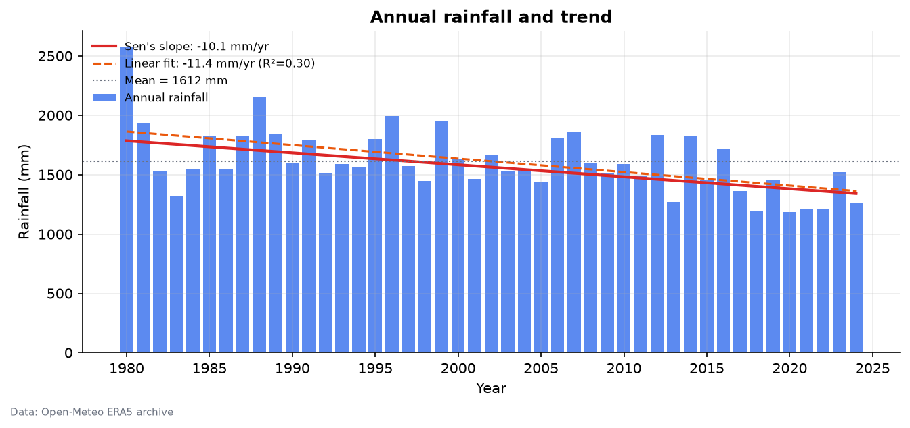
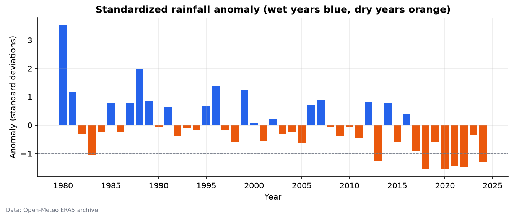
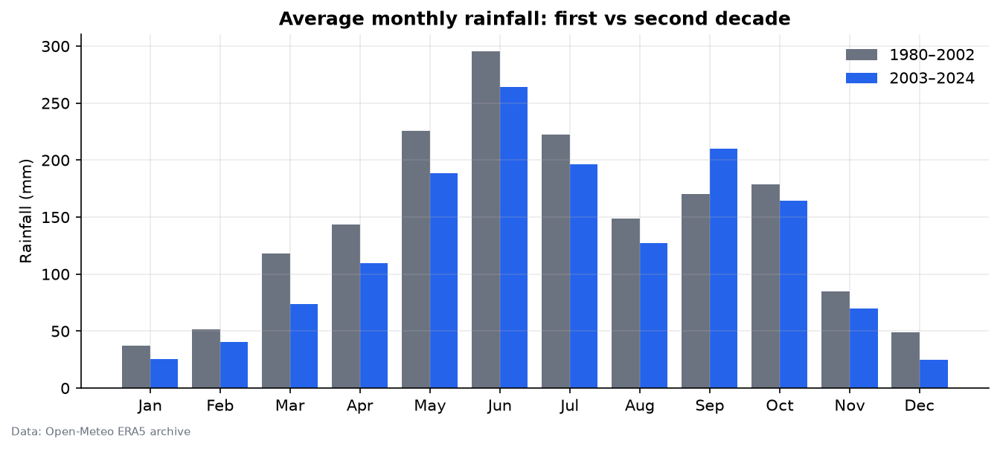
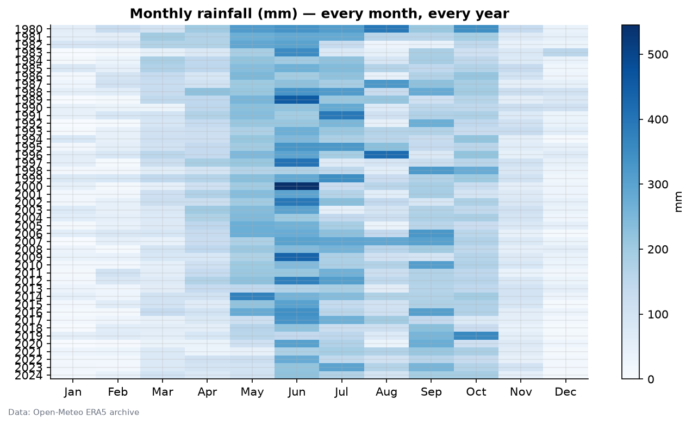
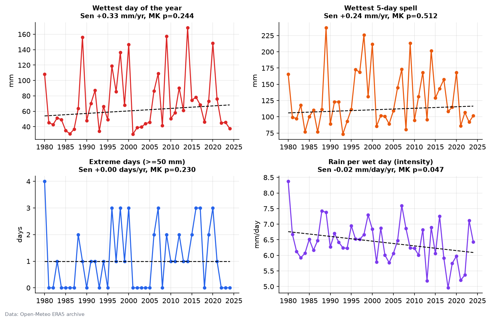
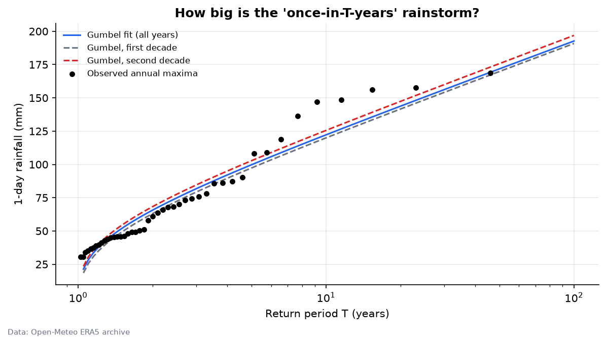
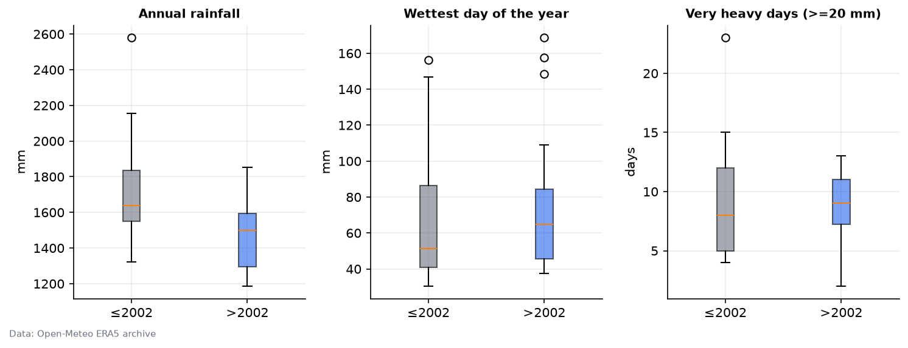

# Project 1 Results — Lagos Metropolitan Area, Nigeria, 1980–2024

*Produced by `analysis.py`. Data source: Open-Meteo ERA5 archive. Years analysed: 45. Wet-day threshold: 1.0 mm. 95th-percentile wet-day rainfall: 17.3 mm.*

## 1. Headline numbers

| Statistic | Value |
|---|---|
| Mean annual rainfall | 1612 mm |
| Standard deviation | 273 mm |
| Coefficient of variation | 16.9 % |
| Wettest year | 1980 (2579 mm) |
| Driest year | 2020 (1186 mm) |
| Wettest single day | 168.6 mm in 2014 |
| Mean PCI | 12.3 |

## 2. Trend tests (Mann-Kendall + Sen's slope + linear regression)

| Index | Mean | Sen's slope /yr | Change over period | MK Z | MK p | Result |
|---|---|---|---|---|---|---|
| Annual rainfall (mm) | 1612.5 | -10.099 | -27.6 % | -3.59 | <0.001 | significant decrease |
| Wet-day rainfall total (mm) | 1573.9 | -10.467 | -29.3 % | -3.61 | <0.001 | significant decrease |
| Number of wet days (days) | 244.5 | -1.000 | -18.0 % | -3.92 | <0.001 | significant decrease |
| Rain per wet day (intensity) (mm/day) | 6.4 | -0.015 | -10.4 % | -1.99 | 0.047 | significant decrease |
| Wettest day of the year (mm) | 72.1 | +0.325 | +19.9 % | +1.16 | 0.244 | no significant trend |
| Wettest 5-day spell (mm) | 126.9 | +0.236 | +8.2 % | +0.66 | 0.512 | no significant trend |
| Heavy-rain days (>=10 mm) (days) | 43.3 | -0.381 | -38.7 % | -2.89 | 0.004 | significant decrease |
| Very heavy days (>=20 mm) (days) | 9.0 | +0.049 | +23.9 % | +1.02 | 0.306 | no significant trend |
| Extreme days (>=50 mm) (days) | 1.1 | +0.000 | +0.0 % | +1.20 | 0.230 | no significant trend |
| Rain from extreme days (>P95) (mm) | 367.5 | +1.966 | +23.5 % | +1.03 | 0.304 | no significant trend |
| Share of rain from extreme days (%) | 23.2 | +0.299 | +56.6 % | +3.20 | 0.001 | significant increase (TFPW p=<0.001) |
| Longest dry spell (days) | 20.4 | +0.193 | +41.7 % | +1.82 | 0.068 | no significant trend |
| Longest wet spell (days) | 38.6 | -0.542 | -61.7 % | -3.73 | <0.001 | significant decrease |
| Precipitation Concentration Index (-) | 12.3 | +0.044 | +15.7 % | +2.85 | 0.004 | significant increase |

**Interpretation:** 
Statistically significant changes (5 % level) were found in: annual rainfall (down 28 % over the period); wet-day rainfall total (down 29 % over the period); number of wet days (down 18 % over the period); rain per wet day (intensity) (down 10 % over the period); heavy-rain days (>=10 mm) (down 39 % over the period); share of rain from extreme days (up 57 % over the period); longest wet spell (down 62 % over the period); precipitation concentration index (up 16 % over the period).

## 3. Seasonal (monthly) trends

| Month | Mean (mm) | Sen's slope (mm/yr) | MK p | Result |
|---|---|---|---|---|
| Jan | 31 | -0.46 | 0.102 | no significant trend |
| Feb | 46 | -0.69 | 0.062 | no significant trend |
| Mar | 96 | -1.90 | <0.001 | significant decrease |
| Apr | 127 | -1.98 | <0.001 | significant decrease |
| May | 207 | -2.51 | <0.001 | significant decrease |
| Jun | 280 | -0.91 | 0.411 | no significant trend |
| Jul | 210 | -1.26 | 0.187 | no significant trend |
| Aug | 138 | -0.08 | 0.907 | no significant trend |
| Sep | 190 | +1.09 | 0.091 | no significant trend |
| Oct | 172 | -0.42 | 0.333 | no significant trend |
| Nov | 77 | -0.70 | 0.027 | significant decrease |
| Dec | 37 | -0.75 | <0.001 | significant decrease |

## 4. Change point and decade comparison

Pettitt test on annual rainfall: K = 278, p = 0.014. Most probable shift after **2012** (mean 1694 mm before vs 1390 mm after) — **statistically significant**.

| Index | 1980–2002 mean | 2003–2024 mean | % change | Welch p | Mann-Whitney p |
|---|---|---|---|---|---|
| Annual rainfall | 1725.6 | 1494.2 | -13.4 % | 0.003 | 0.005 |
| Number of wet days | 253.9 | 234.6 | -7.6 % | 0.008 | 0.010 |
| Rain per wet day (intensity) | 6.6 | 6.2 | -6.6 % | 0.028 | 0.022 |
| Wettest day of the year | 69.5 | 74.8 | +7.6 % | 0.651 | 0.395 |
| Wettest 5-day spell | 126.2 | 127.7 | +1.1 % | 0.913 | 0.691 |
| Very heavy days (>=20 mm) | 9.1 | 8.9 | -2.0 % | 0.880 | 0.665 |
| Extreme days (>=50 mm) | 1.0 | 1.2 | +28.3 % | 0.449 | 0.369 |
| Rain from extreme days (>P95) | 361.6 | 373.7 | +3.4 % | 0.785 | 0.674 |

## 5. Extreme rainfall return levels (Gumbel)

Gumbel parameters (all years): location u = 54.8 mm, scale α = 30.0 mm. Kolmogorov-Smirnov goodness-of-fit p = 0.303 (Gumbel fits acceptably).

| Return period (years) | 1-day rainfall, all years (mm) | first decade (mm) | second decade (mm) |
|---|---|---|---|
| 2 | 65.7 | 63.1 | 68.4 |
| 5 | 99.7 | 97.3 | 102.8 |
| 10 | 122.2 | 119.9 | 125.6 |
| 25 | 150.7 | 148.5 | 154.3 |
| 50 | 171.8 | 169.8 | 175.7 |
| 100 | 192.7 | 190.8 | 196.9 |

**Key finding:** the storm that was a *1-in-10-year* event in the first decade (120 mm/day) behaves like a **1-in-8.4-year** event in the second decade — it has become more frequent.

## 6. Figures

