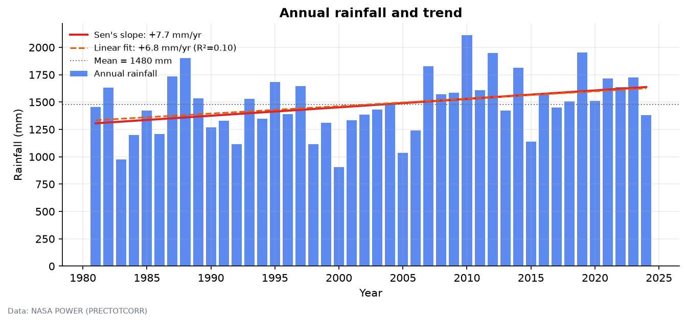
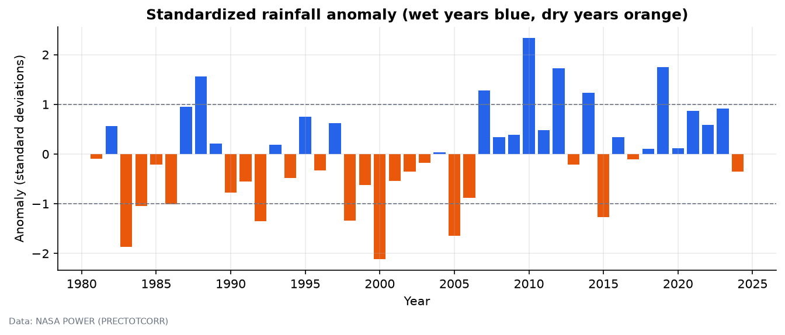
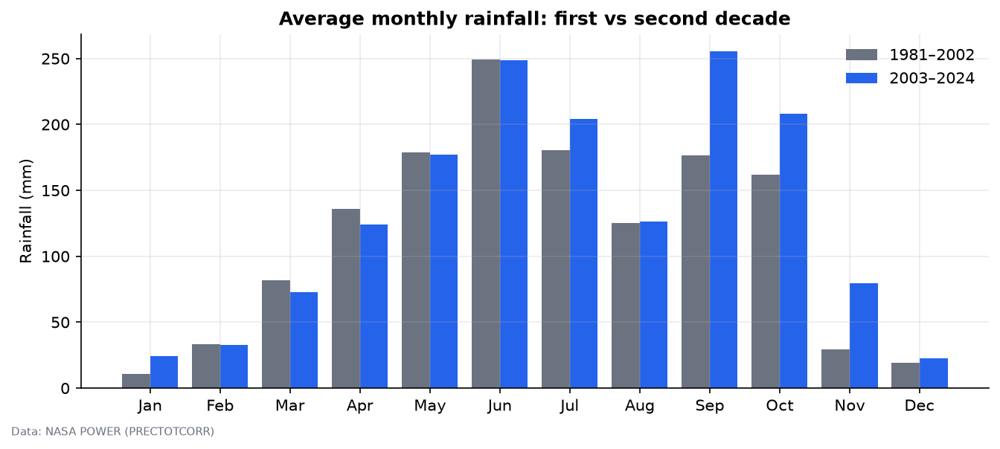
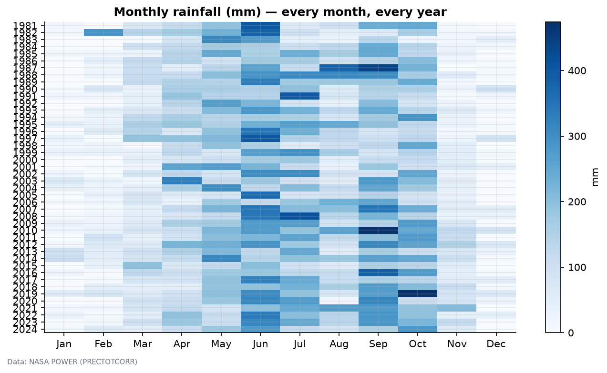
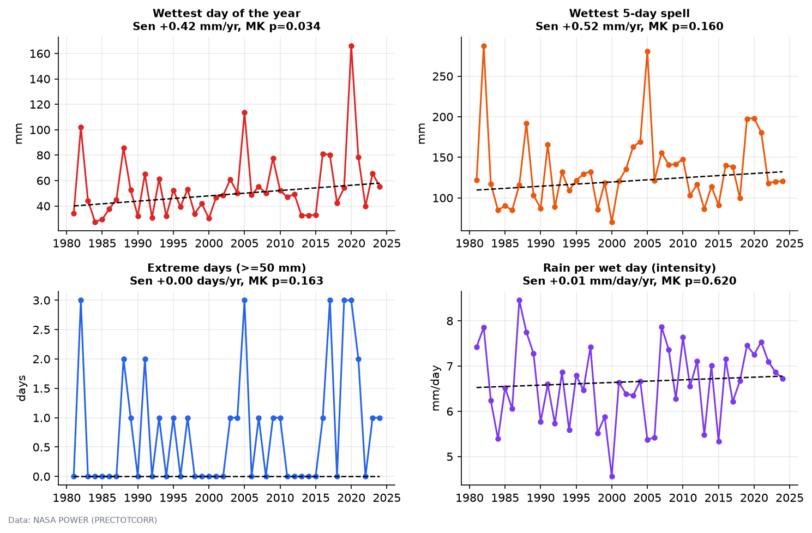
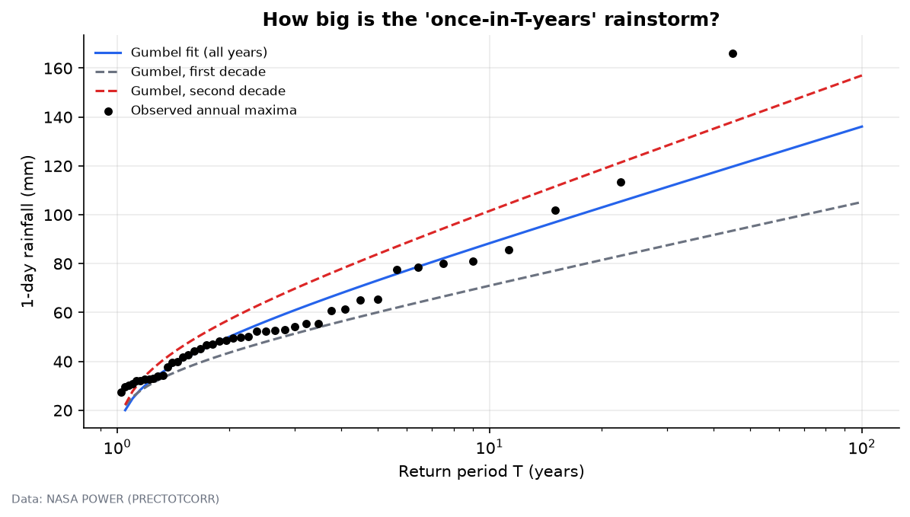
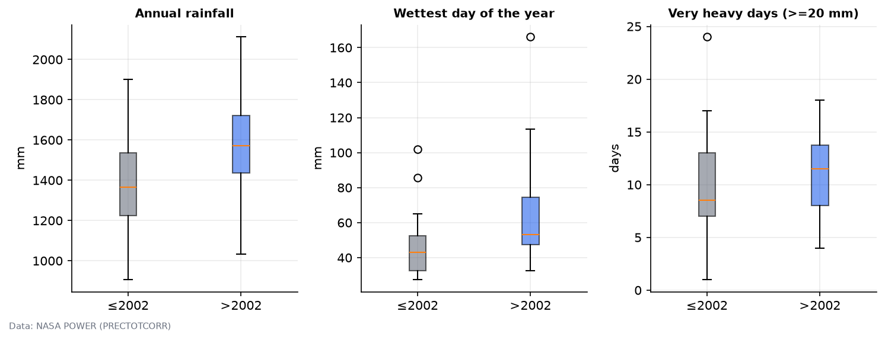

# Project 1 Results — Lagos Metropolitan Area, Nigeria, 1981–2024

*Produced by `analysis.py`. Data source: NASA POWER (PRECTOTCORR). Years analysed: 44. Wet-day threshold: 1.0 mm. 95th-percentile wet-day rainfall: 19.6 mm.*

## 1. Headline numbers

| Statistic | Value |
|---|---|
| Mean annual rainfall | 1480 mm |
| Standard deviation | 271 mm |
| Coefficient of variation | 18.3 % |
| Wettest year | 2010 (2112 mm) |
| Driest year | 2000 (906 mm) |
| Wettest single day | 166.1 mm in 2020 |
| Mean PCI | 13.7 |

## 2. Trend tests (Mann-Kendall + Sen's slope + linear regression)

| Index | Mean | Sen's slope /yr | Change over period | MK Z | MK p | Result |
|---|---|---|---|---|---|---|
| Annual rainfall (mm) | 1479.6 | +7.700 | +22.4 % | +2.19 | 0.028 | significant increase |
| Wet-day rainfall total (mm) | 1446.7 | +7.678 | +22.8 % | +2.11 | 0.035 | significant increase |
| Number of wet days (days) | 218.3 | +0.742 | +14.6 % | +2.98 | 0.003 | significant increase (TFPW p=0.016) |
| Rain per wet day (intensity) (mm/day) | 6.6 | +0.006 | +3.8 % | +0.50 | 0.620 | no significant trend |
| Wettest day of the year (mm) | 54.4 | +0.417 | +33.0 % | +2.12 | 0.034 | significant increase |
| Wettest 5-day spell (mm) | 132.7 | +0.524 | +17.0 % | +1.41 | 0.160 | no significant trend |
| Heavy-rain days (>=10 mm) (days) | 40.2 | +0.088 | +9.4 % | +0.69 | 0.491 | no significant trend |
| Very heavy days (>=20 mm) (days) | 10.5 | +0.000 | +0.0 % | +0.47 | 0.640 | no significant trend |
| Extreme days (>=50 mm) (days) | 0.8 | +0.000 | +0.0 % | +1.39 | 0.163 | no significant trend |
| Rain from extreme days (>P95) (mm) | 330.9 | +2.552 | +33.2 % | +1.04 | 0.298 | no significant trend |
| Share of rain from extreme days (%) | 22.2 | +0.029 | +5.6 % | +0.29 | 0.769 | no significant trend |
| Longest dry spell (days) | 41.0 | -0.222 | -23.3 % | -1.32 | 0.187 | no significant trend |
| Longest wet spell (days) | 57.2 | +0.223 | +16.8 % | +0.98 | 0.326 | no significant trend |
| Precipitation Concentration Index (-) | 13.7 | -0.031 | -9.8 % | -1.83 | 0.067 | no significant trend |

**Interpretation:** 
Statistically significant changes (5 % level) were found in: annual rainfall (up 22 % over the period); wet-day rainfall total (up 23 % over the period); number of wet days (up 15 % over the period); wettest day of the year (up 33 % over the period).

## 3. Seasonal (monthly) trends

| Month | Mean (mm) | Sen's slope (mm/yr) | MK p | Result |
|---|---|---|---|---|
| Jan | 18 | +0.12 | 0.080 | no significant trend |
| Feb | 33 | +0.32 | 0.237 | no significant trend |
| Mar | 77 | +0.16 | 0.769 | no significant trend |
| Apr | 130 | -0.44 | 0.524 | no significant trend |
| May | 178 | -0.67 | 0.473 | no significant trend |
| Jun | 249 | +0.50 | 0.708 | no significant trend |
| Jul | 192 | +1.82 | 0.064 | no significant trend |
| Aug | 126 | +0.22 | 0.800 | no significant trend |
| Sep | 216 | +2.08 | 0.023 | significant increase |
| Oct | 185 | +1.40 | 0.084 | no significant trend |
| Nov | 55 | +1.83 | <0.001 | significant increase |
| Dec | 21 | +0.03 | 0.634 | no significant trend |

## 4. Change point and decade comparison

Pettitt test on annual rainfall: K = 274, p = 0.011. Most probable shift after **2006** (mean 1370 mm before vs 1638 mm after) — **statistically significant**.

| Index | 1981–2002 mean | 2003–2024 mean | % change | Welch p | Mann-Whitney p |
|---|---|---|---|---|---|
| Annual rainfall | 1383.1 | 1576.2 | +14.0 % | 0.016 | 0.017 |
| Number of wet days | 207.1 | 229.5 | +10.8 % | 0.002 | 0.001 |
| Rain per wet day (intensity) | 6.5 | 6.7 | +3.0 % | 0.459 | 0.418 |
| Wettest day of the year | 46.6 | 62.1 | +33.2 % | 0.049 | 0.017 |
| Wettest 5-day spell | 122.4 | 142.9 | +16.7 % | 0.141 | 0.040 |
| Very heavy days (>=20 mm) | 10.1 | 10.9 | +7.2 % | 0.623 | 0.487 |
| Extreme days (>=50 mm) | 0.5 | 1.0 | +100.0 % | 0.103 | 0.082 |
| Rain from extreme days (>P95) | 308.0 | 353.8 | +14.9 % | 0.350 | 0.255 |

## 5. Extreme rainfall return levels (Gumbel)

Gumbel parameters (all years): location u = 42.6 mm, scale α = 20.3 mm. Kolmogorov-Smirnov goodness-of-fit p = 0.316 (Gumbel fits acceptably).

| Return period (years) | 1-day rainfall, all years (mm) | first decade (mm) | second decade (mm) |
|---|---|---|---|
| 2 | 50.1 | 43.6 | 57.1 |
| 5 | 73.1 | 60.1 | 83.9 |
| 10 | 88.4 | 71.0 | 101.6 |
| 25 | 107.6 | 84.8 | 124.0 |
| 50 | 121.9 | 95.0 | 140.5 |
| 100 | 136.1 | 105.2 | 157.0 |

**Key finding:** the storm that was a *1-in-10-year* event in the first decade (71 mm/day) behaves like a **1-in-3.1-year** event in the second decade — it has become more frequent.

## 6. Figures

