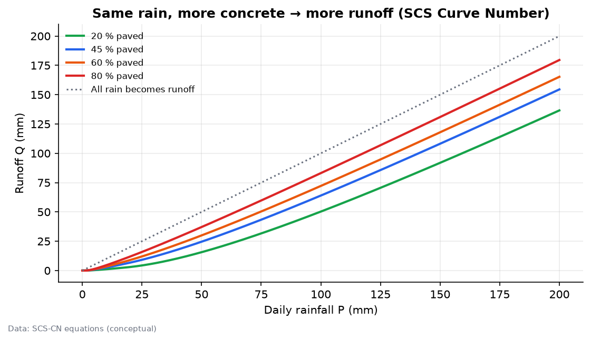
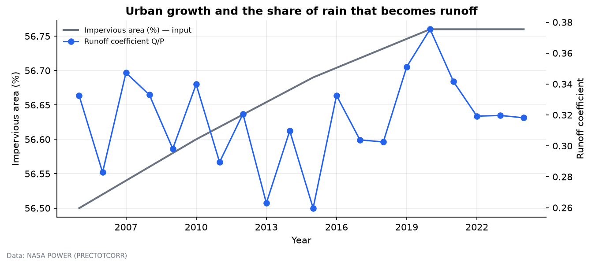
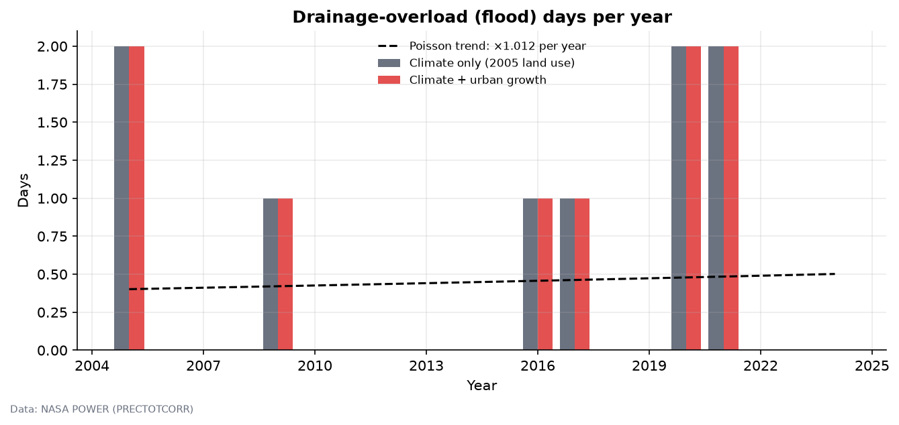
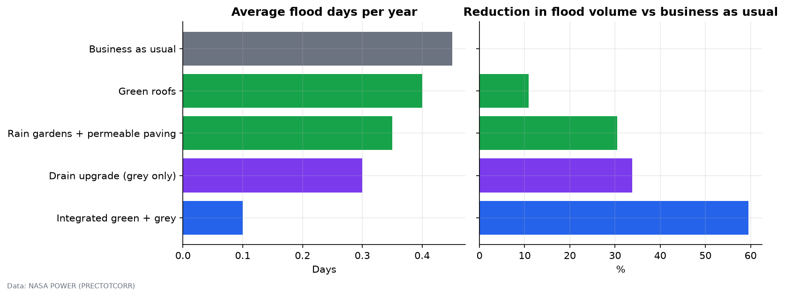
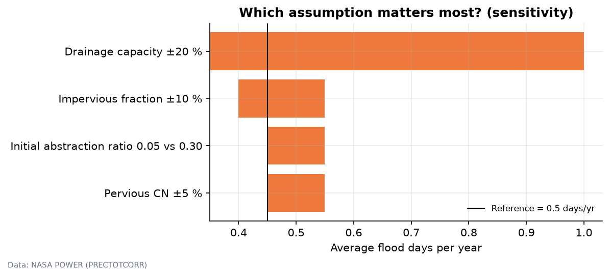

# Project 2 Results — Central Lagos, Lagos, 2005–2024

*Produced by `analysis.py`. Rainfall: NASA POWER (PRECTOTCORR). Catchment: 23.8 km² of land centred on 6.5244° N, 3.3792° E. Drainage capacity 40 mm/day, CN pervious 74 / impervious 98. Impervious fraction 56 % → 57 % (GHSL built-up surface, set in `config.yaml`).*

## 1. Flood-trend statistics

| Variable | Scenario | Mean | Sen's slope /yr | % change over period | MK p | Result |
|---|---|---|---|---|---|---|
| Flood days/yr | Climate + urban | 0.45 | +0 | +0.0 % | 0.871 | no significant trend |
| Flood days/yr | Climate only | 0.45 | +0 | +0.0 % | 0.871 | no significant trend |
| Excess volume (m³/yr) | Climate + urban | 2.69e+05 | +0 | +0.0 % | 1.000 | no significant trend |
| Excess volume (m³/yr) | Climate only | 2.68e+05 | +0 | +0.0 % | 1.000 | no significant trend |
| Runoff coefficient | Climate + urban | 0.317 | +0.000615 | +3.7 % | 0.673 | no significant trend |
| Runoff coefficient | Climate only | 0.316 | +0.000533 | +3.2 % | 0.721 | no significant trend |
| Max daily runoff (mm) | Climate + urban | 42.2 | +0.0108 | +0.5 % | 0.974 | no significant trend |
| Max daily runoff (mm) | Climate only | 42.2 | +0.00481 | +0.2 % | 0.974 | no significant trend |

**Poisson regression of flood days (climate + urban):** IRR = 1.012 (95 % CI 0.903–1.133), p = 0.840, dispersion = 1.35. This means the expected number of flood days changes by **+1.2 % per year**, i.e. ×1.25 over 19 years.
With land use frozen at 2005, the same model gives IRR = 1.012 (p = 0.840).

## 2. Attribution — how much is climate, how much is urban growth?

Change in the average of 2015–2024 compared with 2005–2014:

| Quantity | Total change | Due to rainfall change | Due to urban growth | Urban share |
|---|---|---|---|---|
| flood_days | +0.3 | +0.3 | +0 | 0 % |
| excess_volume_m3 | +1.73e+05 | +1.71e+05 | +1.89e+03 | 1 % |
| runoff_mm | -0.091 | -1.21 | +1.12 | n/a (total change close to zero) |

*Method: run the model twice — once with real land-use growth, once with land use frozen at 2005. The difference between the two runs is the effect of urbanisation.*

## 3. Sustainable drainage (SuDS) scenarios

Each scenario applies 2024 land use to all 20 years of observed rainfall.

| Scenario | Flood days/yr | Excess m³/yr | Runoff coeff. | Flood-day reduction | Volume reduction |
|---|---|---|---|---|---|
| Business as usual | 0.45 | 268,988 | 0.317 | 0 % | 0 % |
| Green roofs | 0.40 | 239,607 | 0.290 | 11 % | 11 % |
| Rain gardens + permeable paving | 0.35 | 186,901 | 0.277 | 22 % | 31 % |
| Drain upgrade (grey only) | 0.30 | 178,083 | 0.317 | 33 % | 34 % |
| Integrated green + grey | 0.10 | 108,788 | 0.249 | 78 % | 60 % |

**Best performing strategy:** Integrated green + grey (60 % less floodwater).

## 4. Sensitivity analysis

| Parameter varied | Flood days/yr (low) | Flood days/yr (high) |
|---|---|---|
| Drainage capacity ±20 % | 1.00 | 0.35 |
| Impervious fraction ±10 % | 0.40 | 0.55 |
| Initial abstraction ratio 0.05 vs 0.30 | 0.55 | 0.45 |
| Pervious CN ±5 % | 0.45 | 0.55 |

The result is most sensitive to **drainage capacity** — this is the parameter most worth measuring carefully.

## Figures

