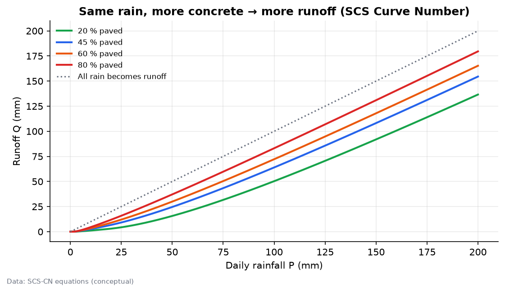
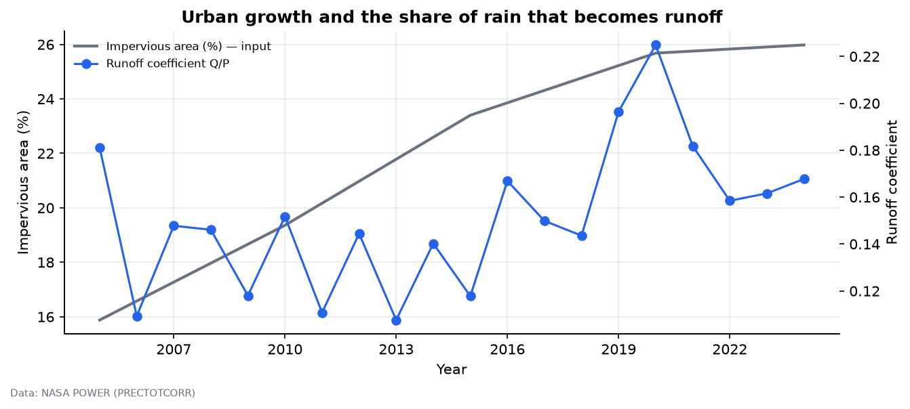
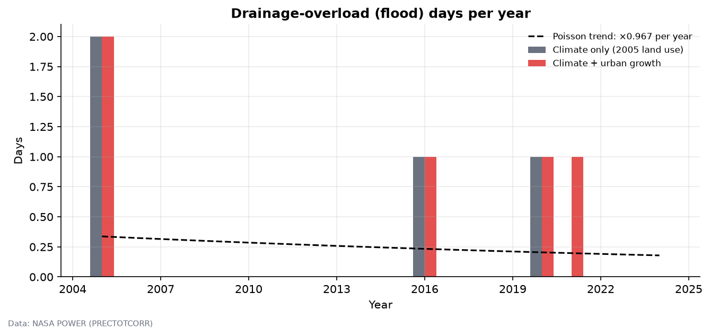
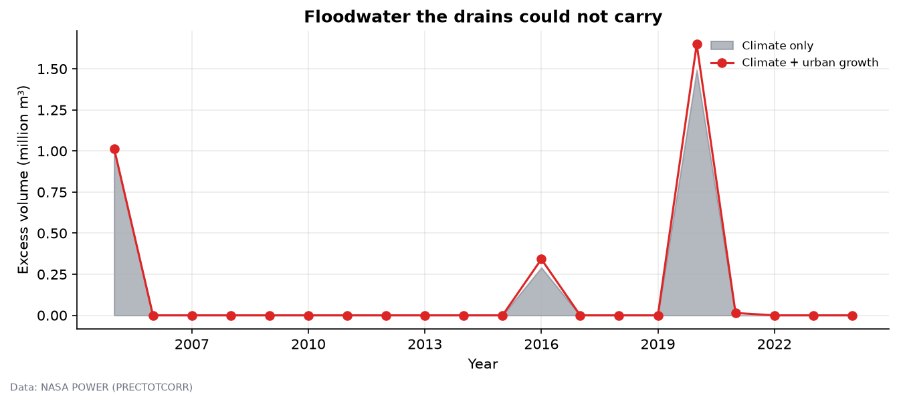
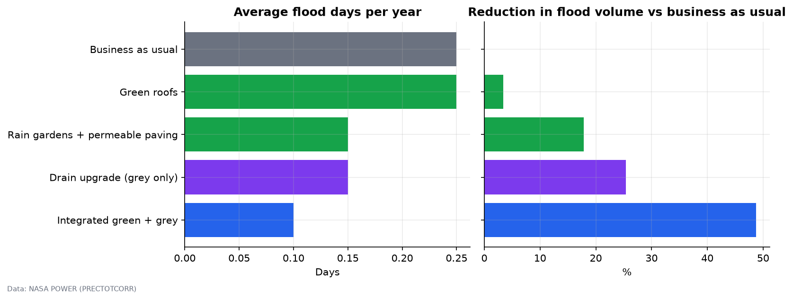
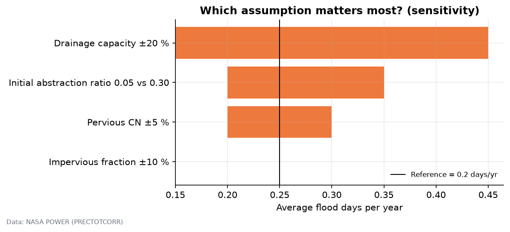

# Project 2 Results — Lekki–Ajah corridor, Lagos, 2005–2024

*Produced by `analysis.py`. Rainfall: NASA POWER (PRECTOTCORR). Catchment: 23.6 km² of land centred on 6.445° N, 3.545° E. Drainage capacity 40 mm/day, CN pervious 74 / impervious 98. Impervious fraction 16 % → 26 % (GHSL built-up surface, set in `config.yaml`).*

## 1. Flood-trend statistics

| Variable | Scenario | Mean | Sen's slope /yr | % change over period | MK p | Result |
|---|---|---|---|---|---|---|
| Flood days/yr | Climate + urban | 0.25 | +0 | +0.0 % | 0.851 | no significant trend |
| Flood days/yr | Climate only | 0.2 | +0 | +0.0 % | 0.752 | no significant trend |
| Excess volume (m³/yr) | Climate + urban | 1.51e+05 | +0 | +0.0 % | 0.815 | no significant trend |
| Excess volume (m³/yr) | Climate only | 1.4e+05 | +0 | +0.0 % | 0.874 | no significant trend |
| Runoff coefficient | Climate + urban | 0.151 | +0.00258 | +32.4 % | 0.048 | significant increase |
| Runoff coefficient | Climate only | 0.121 | -0.000445 | -7.0 % | 0.770 | no significant trend |
| Max daily runoff (mm) | Climate + urban | 32.4 | +0.29 | +17.0 % | 0.770 | no significant trend |
| Max daily runoff (mm) | Climate only | 30.8 | +0.13 | +8.0 % | 0.871 | no significant trend |

**Poisson regression of flood days (climate + urban):** IRR = 0.967 (95 % CI 0.829–1.128), p = 0.671, dispersion = 1.17. This means the expected number of flood days changes by **-3.3 % per year**, i.e. ×0.53 over 19 years.
With land use frozen at 2005, the same model gives IRR = 0.909 (p = 0.312).

## 2. Attribution — how much is climate, how much is urban growth?

Change in the average of 2015–2024 compared with 2005–2014:

| Quantity | Total change | Due to rainfall change | Due to urban growth | Urban share |
|---|---|---|---|---|
| flood_days | +0.1 | +0 | +0.1 | 100 % |
| excess_volume_m3 | +9.91e+04 | +7.7e+04 | +2.22e+04 | 22 % |
| runoff_mm | +43.8 | -0.457 | +44.3 | 101 % |

*Method: run the model twice — once with real land-use growth, once with land use frozen at 2005. The difference between the two runs is the effect of urbanisation.*

## 3. Sustainable drainage (SuDS) scenarios

Each scenario applies 2024 land use to all 20 years of observed rainfall.

| Scenario | Flood days/yr | Excess m³/yr | Runoff coeff. | Flood-day reduction | Volume reduction |
|---|---|---|---|---|---|
| Business as usual | 0.25 | 158,557 | 0.169 | 0 % | 0 % |
| Green roofs | 0.25 | 153,177 | 0.157 | 0 % | 3 % |
| Rain gardens + permeable paving | 0.15 | 130,283 | 0.151 | 40 % | 18 % |
| Drain upgrade (grey only) | 0.15 | 118,325 | 0.169 | 40 % | 25 % |
| Integrated green + grey | 0.10 | 81,275 | 0.138 | 60 % | 49 % |

**Best performing strategy:** Integrated green + grey (49 % less floodwater).

## 4. Sensitivity analysis

| Parameter varied | Flood days/yr (low) | Flood days/yr (high) |
|---|---|---|
| Drainage capacity ±20 % | 0.45 | 0.15 |
| Initial abstraction ratio 0.05 vs 0.30 | 0.35 | 0.20 |
| Pervious CN ±5 % | 0.20 | 0.30 |
| Impervious fraction ±10 % | 0.25 | 0.25 |

The result is most sensitive to **drainage capacity** — this is the parameter most worth measuring carefully.

## Figures

